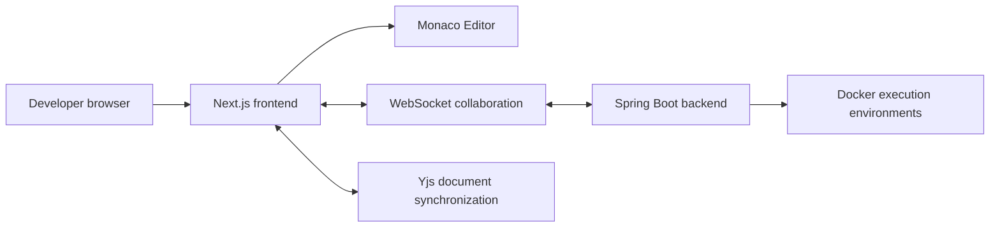

# ColabIDE

A browser-based collaborative code editor for writing and running code, with real-time collaboration and containerized execution.


## Overview

ColabIDE is an online code editor intended to let developers write, execute, and collaborate on code from a browser. The repository contains a Spring Boot backend in `CollaborativeEditor/` and a Next.js frontend in `collaborative-editor-frontend/`.

## Features

- **Browser-based editing:** Monaco Editor provides the code-editing experience.
- **Multi-language execution:** The project README describes support for Java, Python, C++, JavaScript, and other languages.
- **Real-time collaboration:** WebSocket communication and Yjs are used for shared editing and synchronization.
- **Cursor awareness:** Remote cursor tracking is implemented using Monaco decorations.
- **Containerized execution:** Docker is used to isolate code execution environments.
- **Editor experience:** Syntax highlighting, themes, and an integrated terminal are part of the documented feature set.

## Architecture

At a high level, the repository is split into two applications:



The diagram is a conceptual overview based on the components documented in this repository; consult the source code for implementation details.

## Technology Stack

| Layer | Technologies |
|---|---|
| Frontend | Next.js, React, Monaco Editor |
| Collaboration | Yjs, WebSocket |
| Backend | Java, Spring Boot |
| Code execution | Docker |
| Supported languages | Java, Python, C++, JavaScript (as documented) |

## Demo

A project demo video is available here:

[Watch the ColabIDE demo](https://sfmrqycwibsrxzmucyzr.supabase.co/storage/v1/object/public/project-images/output.mp4)

## Getting Started

### Prerequisites

- Java 17 or later
- Node.js 14 or later
- Docker
- npm

### 1. Start the backend

From the repository root:

```bash
cd CollaborativeEditor

# macOS / Linux
./mvnw spring-boot:run

# Windows
.\\mvnw.cmd spring-boot:run
```

The existing project instructions indicate that the backend listens on `http://localhost:8080`.

### 2. Start the frontend

Open a second terminal:

```bash
cd collaborative-editor-frontend
npm install
npm run dev
```

The existing project instructions indicate that the frontend is available at `http://localhost:3000`.

### Configuration

Review the backend and frontend configuration files before running the application. Configure any required service URLs, environment variables, and Docker settings for your local environment. Do not commit credentials or secret values.

## Repository Layout

```text
ColabIDE/
├── CollaborativeEditor/          # Spring Boot backend
├── collaborative-editor-frontend/ # Next.js frontend
└── README.md
```

## Current Scope and Future Work

The original project notes list the following as planned enhancements. Their current implementation status should be verified against the source before treating them as completed:

- [ ] Expand language support
- [ ] Authentication and authorization
- [ ] Project sharing
- [ ] Custom theme editor
- [ ] Integrated debugging tools

## Contributing

1. Fork the repository.
2. Create a feature branch.
3. Make focused changes and add or update tests.
4. Run the relevant backend and frontend checks.
5. Open a pull request describing the change.

---

Built as a collaborative development environment for the browser.
